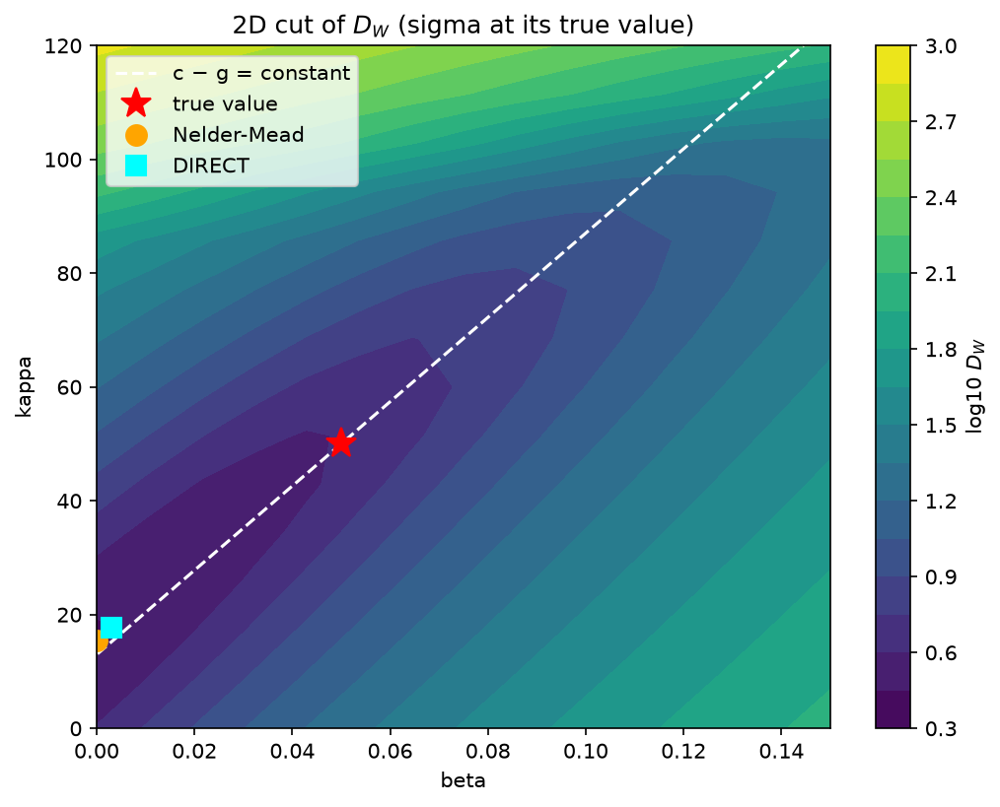
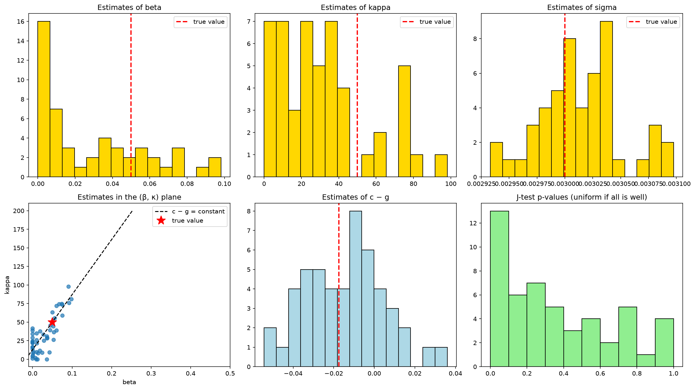
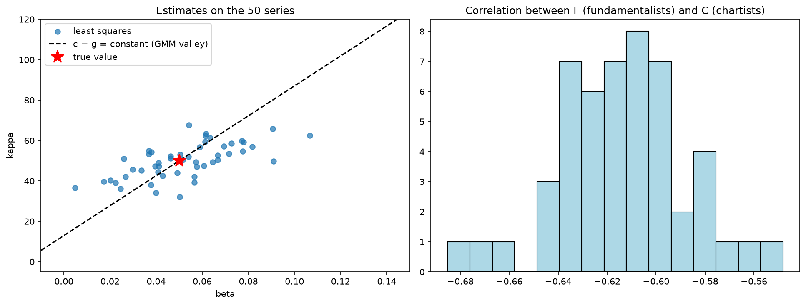
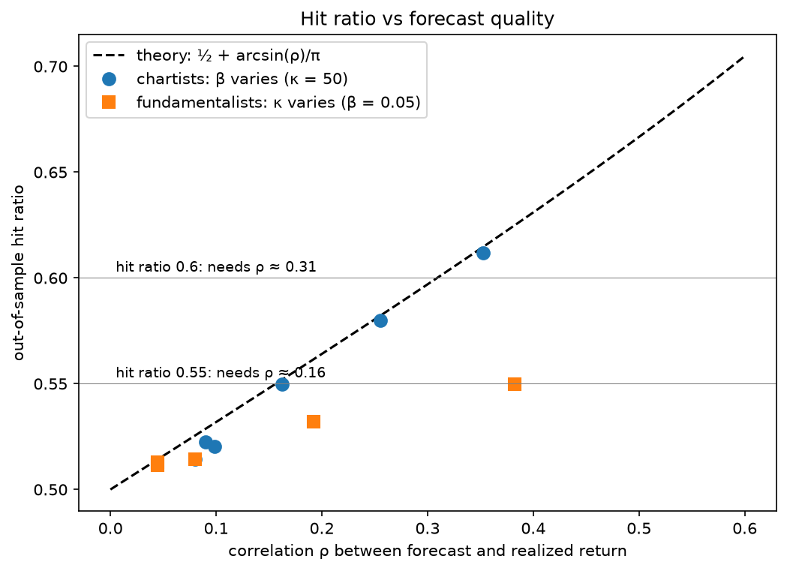
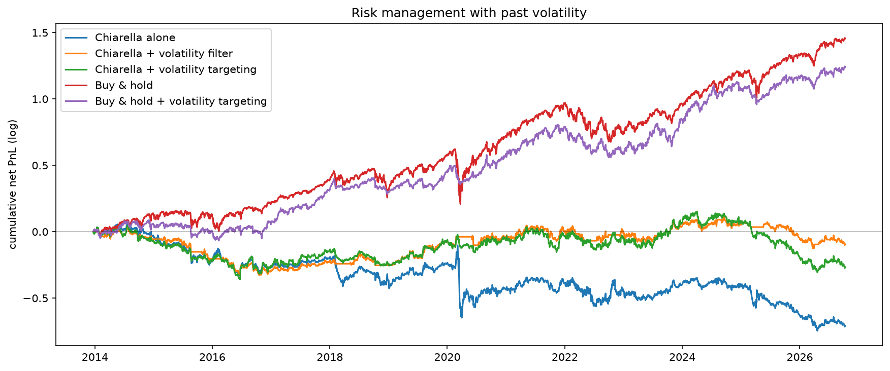

# Calibrating and predicting markets with an agent-based model

*Personal rework of a 5-student group project — CentraleSupélec, ST4 integration course "Statistical analysis of financial markets", 2026, supervised by D. Challet (group grade: 18/20). Every notebook, analysis and conclusion in this repository was redone and extended by me.*

> **Can an agent-based model be calibrated on market data, and used to predict returns?**
> Six steps with the modified Chiarella model (chartists vs fundamentalists): simulation, method-of-moments
> calibration (GMM), neural surrogate, trajectory calibration, real trader behaviour (NFT) and prediction
> (S&P 500, currencies).

**In one sentence:** even when the model is exactly true, a price series only carries about two combinations of its six parameters and predicts the sign of tomorrow's return only 52 % of the time; on real markets this weak signal vanishes. The project **measures** each reason for this failure.

---

## The model

Two types of agents trade one asset:
- **chartists** follow the trend $m_t$, an exponential moving average of returns (memory α);
- **fundamentalists** pull the price towards a fundamental value $v_t$, an exponential moving average of prices (memory λ).

$$
r_{t+1} = \kappa\big[(v_t-p_t)^3-(v_{t-1}-p_{t-1})^3\big] + \beta\big[\tanh(\gamma m_t)-\tanh(\gamma m_{t-1})\big] + \varepsilon_{t+1},
\qquad \varepsilon_t \sim \mathcal N(0, \sigma^2)
$$

$$
m_t = (1-\alpha)\,m_{t-1} + \alpha\,(p_t - p_{t-1}), \qquad v_t = (1-\lambda)\,v_{t-1} + \lambda\,p_t
$$

Six parameters: β, κ, γ, α, λ, σ.

---

## Main results

| Part | Question | Result |
|---|---|---|
| **1. Model** | Does the model look like a real market? | Not at the daily scale: no fat tails or volatility clustering with realistic parameters (constant-variance noise). Consistent at the monthly scale. |
| **2. GMM** | Can the parameters be recovered from statistics? | σ within 1.3 %, but β and κ with 60–70 % error: the data only see the gap between momentum and mean reversion. |
| **3. Surrogate** | Does a neural network help? | 60× faster per calibration (pays off after ≈ 10 calibrations), but no gain in precision. |
| **4. Trajectory** | Does step-by-step fitting do better? | Yes: κ within 17 % instead of 60 %, β 41 % instead of 71 %, in 1 ms per calibration. β, γ and α remain indistinguishable. |
| **5. NFT traders** | Do the model's agents exist? | Yes, but as a minority (9 % trend followers, 8 % mean reverters, 3.5× chance), on short horizons (12 and 5 days), with no stability or persistent skill. |
| **6. Prediction** | Does the model predict markets? | Ceiling of 52 % correct signs even when the model is true. On the S&P 500 and 9 currency pairs: not significant, and beaten by a naive rule. The best strategy is volatility-based risk management, without the model. |

Details and figures are in the conclusion of each notebook.

---

## Key figures

**Identifiability: the GMM only sees one combination of parameters.** 2D cut of the objective in the (β, κ) plane: the valley follows c − g = constant (momentum minus mean reversion). The optimizers find the valley floor, not the true value (star).



**Monte Carlo over 50 series: GMM vs trajectory calibration.** With the GMM (first figure, bottom left), the β and κ estimates spread along the valley. Fitting returns step by step (second figure, left), they cluster around the true value.





**The prediction ceiling.** Out-of-sample hit ratio vs the correlation ρ between forecast and return: it follows Sheppard's formula ½ + arcsin(ρ)/π. In realistic regimes ρ stays below 0.1, i.e. a hit ratio of about 0.52 at best.



**S&P 500: risk management beats the model.** The best risk-adjusted PnL comes from buy & hold with volatility targeting, without the Chiarella model.



---

## Project outline

| Notebook | Content |
|---|---|
| [`01_model.ipynb`](notebooks/01_model.ipynb) | Simulator, model regimes (maps of fat tails, clustering and explosions), comparison with the S&P 500 |
| [`02_gmm.ipynb`](notebooks/02_gmm.ipynb) | Sensitivity analysis (Jacobian, SVD), GMM, Hansen matrix, J-test, numba speed-up, Monte Carlo of the estimator |
| [`03_surrogate.ipynb`](notebooks/03_surrogate.ipynb) | Latin Hypercube Sampling, PyTorch MLP, noise floor, GMM with the surrogate, break-even point |
| [`04_trajectory.ipynb`](notebooks/04_trajectory.ipynb) | State reconstruction, regression, non-linear optimization (L-BFGS-B, simulated annealing) |
| [`05_nft.ipynb`](notebooks/05_nft.ipynb) | 2.4 million NFT sales: trader classification, stability, horizons, smart money |
| [`06_prediction.ipynb`](notebooks/06_prediction.ipynb) | Theoretical ceiling (Sheppard), rolling-window S&P 500, fat tails, volatility targeting, 9 currency pairs |

The original assignment and what I changed are summarized in [`docs/assignment.md`](docs/assignment.md).

---

## Methods

- **Econometrics**: generalized method of moments (GMM), Hansen's optimal weighting matrix, J-test, conditional maximum likelihood, robust least squares (Huber, winsorization), multiple testing (Bonferroni), permutation tests.
- **Identifiability**: normalized Jacobian, singular value decomposition, *sloppiness*.
- **Optimization**: Nelder-Mead, DIRECT, L-BFGS-B, simulated annealing.
- **Machine learning**: neural surrogate (PyTorch MLP), Latin Hypercube Sampling, early stopping.
- **Computing**: numba compilation (×90), joblib parallelism, polars and Parquet (2.4 million rows).
- **Finance**: rolling-window backtest without look-ahead bias, transaction costs, Sharpe ratio, maximum drawdown, volatility targeting.

---

## Repository structure

```
.
├── README.md
├── requirements.txt
├── docs/
│   └── assignment.md      summary of the original assignment, and what I changed
├── figures/               key figures, exported by the notebooks
├── data/
│   ├── sp500_daily.csv    daily S&P 500, 2010–2026 (Yahoo Finance)
│   ├── fx_daily.csv       9 daily currency pairs (Yahoo Finance)
│   └── nft/               NFT sales (not versioned, see below)
└── notebooks/
    ├── abm.py             shared code: simulators, statistics, GMM, calibration, evaluation
    └── 01_model.ipynb … 06_prediction.ipynb
```

---

## Reproducing the results

```bash
python -m venv .venv
.venv\Scripts\activate          # Linux / macOS: source .venv/bin/activate
pip install -r requirements.txt
```

Then run the notebooks in order from the `notebooks/` folder. All simulations use fixed seeds, so results are reproducible.

**Data.**
- `sp500_daily.csv` and `fx_daily.csv` are included. They come from Yahoo Finance via `yfinance` (`^GSPC`, and pairs `EURUSD=X`, `GBPUSD=X`…).
- NFT sales (3.3 GB) are not versioned: download `sales.csv` from the [MultiNFT](https://multinft-dataset.github.io/) dataset (Zenodo, record 17214886), put it in `data/nft/`, then convert it to Parquet:

```python
import polars as pl

numeric = {c: pl.Float64 for c in ["quantity", "payment_quantity", "payment_decimals", "eth_usd_price",
                                   "avg_gas_price", "payment_usd_price", "log_usd_price"]}
(
    pl.scan_csv("data/nft/sales.csv", infer_schema_length=0, schema_overrides=numeric)
    .with_columns(
        pl.col("event_timestamp").str.replace(r"\+00:00$", "").str.to_datetime("%Y-%m-%d %H:%M:%S", strict=False),
        pl.col("closing_date").str.to_date("%Y-%m-%d", strict=False),
    )
    .sink_parquet("data/nft/sales.parquet", compression="zstd")
)
```

---

## References

- Majewski, Ciliberti, Bouchaud (2020). *Co-existence of trend and value in financial markets: Estimating an extended Chiarella model.* Journal of Economic Dynamics and Control.
- Hansen (1982). *Large sample properties of generalized method of moments estimators.* Econometrica.
- Lamperti, Roventini, Sani (2018). *Agent-based model calibration using machine learning surrogates.* Journal of Economic Dynamics and Control.
- Lillo et al. (2008). *Specialization and herding behavior of trading firms in a financial market.* New Journal of Physics.
- Moreira, Muir (2017). *Volatility-managed portfolios.* Journal of Finance.

---

## Credits

The original group project was carried out with Alban Derue, Sacha Jarnet, Baptiste Alonso and Niven Yem Enyegue, as part of CentraleSupélec's ST4 integration course, supervised by D. Challet (group grade: 18/20). The assignment is his; see [`docs/assignment.md`](docs/assignment.md) for a summary.

**This repository is a personal rework**: I rewrote the code from scratch, fixed errors of the group version, and extended every part (identifiability analysis, Hansen weighting and J-test, Monte Carlo studies, surrogate break-even, trajectory calibration, NFT significance tests, prediction ceiling, robustness and risk management, currencies).
